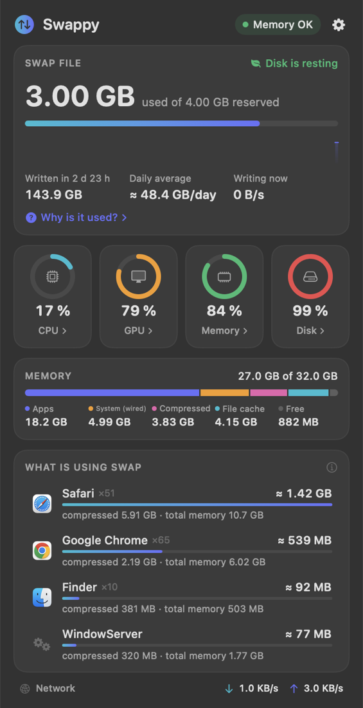
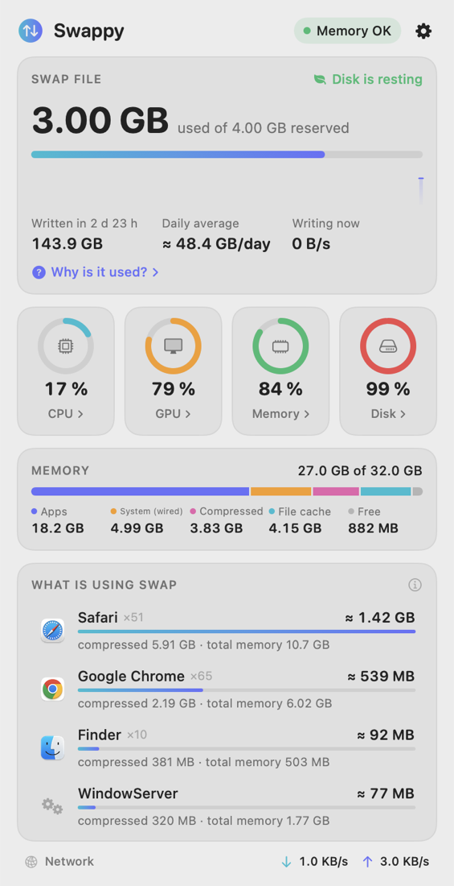
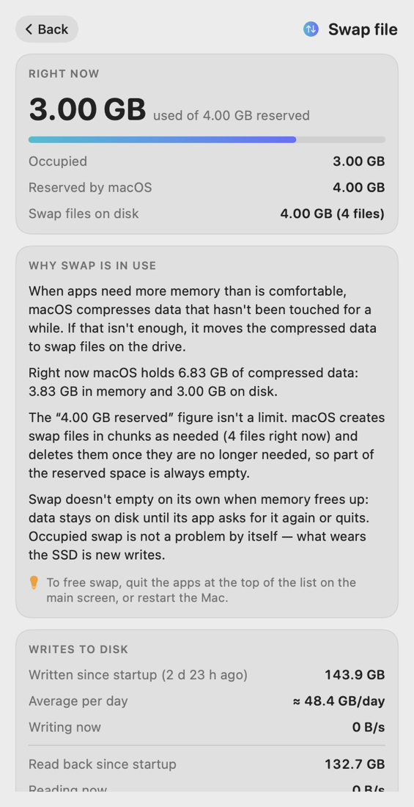
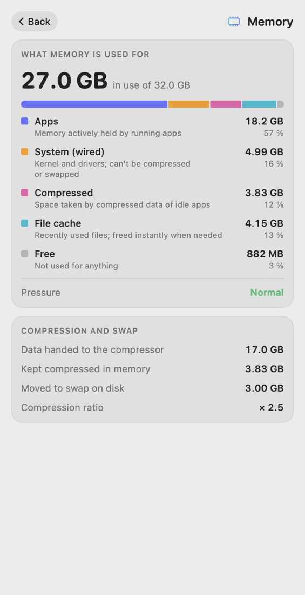
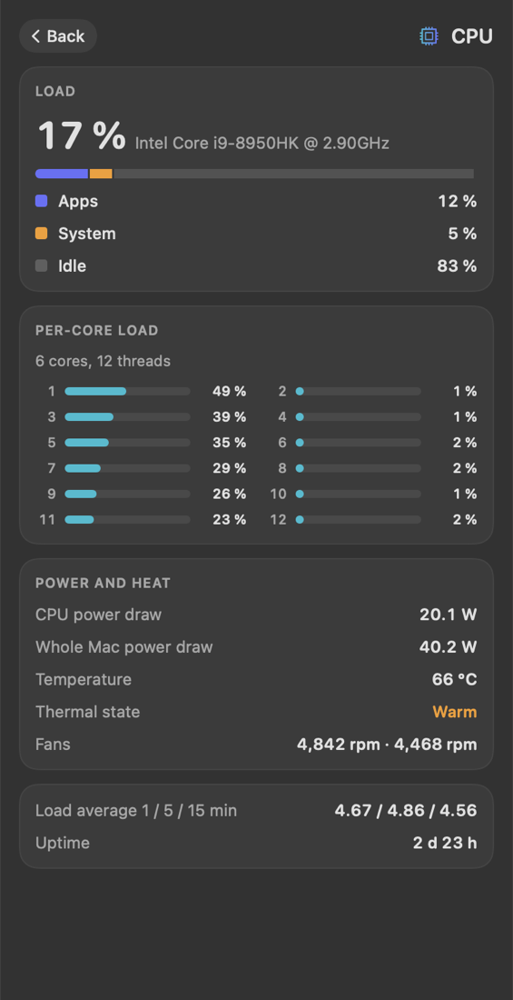

<div align="center">

 

# Swappy

**See what is filling your Mac's swap — and how much it is writing to your SSD.**

Menu bar app · Desktop & Notification Center widgets · Apple Silicon + Intel · macOS 13+

[Русская версия](README.ru.md)

</div>

---

## What it does

| | |
|---|---|
| **Swap at a glance** | Used and reserved swap in the menu bar, a 10-minute history, how much has been written to disk since startup and the daily average. |
| **Who is using it** | Apps ranked by their share of swap. Browser tabs and helper processes are counted with their app. |
| **Why it is used** | A plain-language explanation built from your Mac's live numbers. |
| **System details** | Click CPU, GPU, Memory or Disk for per-core load, power draw, temperature, fans, memory breakdown, disk activity. |
| **Widgets** | Small and medium widgets for the desktop and Notification Center (macOS 14+). |
| **Light on energy** | A few kernel counters every 10 s while closed; ~0 % CPU when idle. |
| **8 languages** | English, Русский, Deutsch, Français, Español, Português, 简体中文, 日本語. |

<div align="center">
  
</div>

## Install

### Option 1 — download

1. Open the [**Releases**](https://github.com/SideAppIon/Swappy/releases) page and download `Swappy.zip`.
2. Unzip it and drag **Swappy** into your **Applications** folder.
3. Swappy isn't notarized by Apple, so macOS blocks the first launch. Clear the download flag once in Terminal:

   ```bash
   xattr -dr com.apple.quarantine /Applications/Swappy.app
   ```

   Prefer not to use Terminal? Open Swappy, dismiss the warning, then go to **System Settings → Privacy & Security** and click **Open Anyway**.
4. Open Swappy. Its icon ⇅ appears in the menu bar.

### Option 2 — build from source

You need [Xcode](https://apps.apple.com/app/xcode/id497799835) 15 or newer.

```bash
git clone https://github.com/SideAppIon/Swappy.git
```

```bash
cd Swappy && ./Scripts/build.sh
```

```bash
cp -R build/Swappy.app /Applications/ && open /Applications/Swappy.app
```

An app you build yourself opens without any Gatekeeper warning.

## Add the widgets

Widgets need macOS 14 (Sonoma) or newer, and Swappy must be in **Applications** and opened at least once.

1. Right-click the desktop and choose **Edit Widgets…** (or click the date in the menu bar and choose **Edit Widgets** at the bottom).
2. Search for **Swappy**.
3. Drag the small or medium widget to the desktop or into Notification Center.

macOS decides how often widgets refresh (usually every few minutes); the menu bar app is always live.

## Using it

- **Click the menu bar icon** to open the window.
- **Click the swap card** to learn why swap is in use on your Mac right now.
- **Click CPU / GPU / Memory / Disk** for details.
- **Hover an app** in the list and press ✕ to quit it and release its swap. Swappy always asks for confirmation first.
- **Gear menu**: theme, menu bar style, language, launch at login.

## How the numbers are made

- **Per-app swap (≈)** is an estimate. macOS reports each process's compressed memory but not which part has already been moved to disk, so used swap is divided in proportion to compressed memory.
- **Written to disk** is the kernel's swap-out counter since the last startup. The daily average divides it by uptime.
- **"Reserved"** is the total size of the swap files macOS has created so far. It is not a limit: macOS adds and removes swap files as needed.
- **Power, temperature and fans** come from the Mac's SMC sensors and are shown only where the hardware exposes them. They were tested on an Intel MacBook Pro; on Apple Silicon some rows may be missing.

## Privacy

Swappy reads system counters locally. It makes no network connections and collects nothing.

## For developers

```
Sources/Swappy    menu bar app (SwiftUI + AppKit)
Sources/Shared    sampler, formatting, localization (shared with the widget)
Sources/Widget    WidgetKit extension
Sources/CSwappy   C shim: kernel ledger and SMC access
project.yml       XcodeGen spec for Swappy.xcodeproj
```

- `./Scripts/build.sh` — universal `build/Swappy.app`.
- `./Scripts/package.sh` — the same plus `build/Swappy.zip` for a release.
- `Swappy --snapshot out.png [--page swap|cpu|gpu|ram|ssd] [--lang ru]` — render the window off-screen in both themes.
- Strings for all languages live in `Sources/Shared/Strings.swift`.
