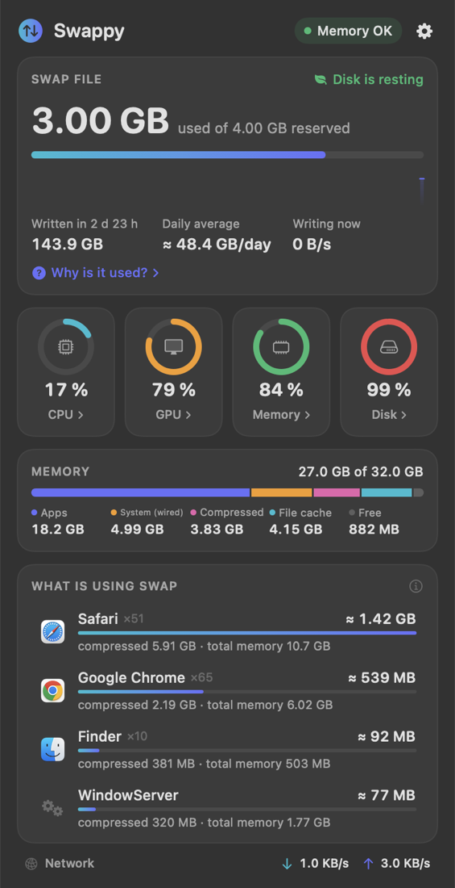
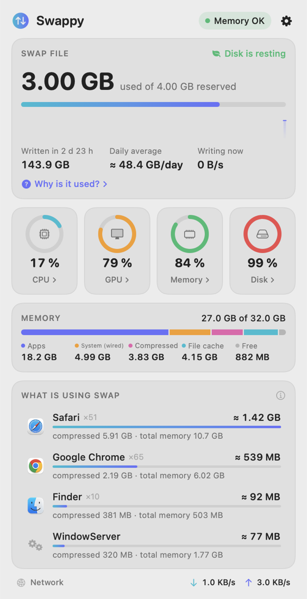

<div align="center">

 

# Swappy

**Показывает, чем занят файл подкачки вашего Mac и сколько он пишет на SSD.**

Приложение в строке меню · Виджеты для рабочего стола и Центра уведомлений · Apple Silicon + Intel · macOS 13+

[English version](README.md)

</div>

---

## Что умеет

| | |
|---|---|
| **Swap с одного взгляда** | Занятый и выделенный swap в строке меню, история за 10 минут, объём записи на диск с включения Mac и среднее за сутки. |
| **Кто его занимает** | Программы по доле в swap. Вкладки браузера и вспомогательные процессы отнесены к своей программе. |
| **Почему он занят** | Объяснение простым языком на живых цифрах вашего Mac. |
| **Подробности о системе** | Нажмите «Процессор», «Графика», «Память» или «Диск»: загрузка ядер, потребление, температура, вентиляторы, состав памяти, активность диска. |
| **Виджеты** | Малый и средний виджеты для рабочего стола и Центра уведомлений (macOS 14+). |
| **Бережёт энергию** | Несколько счётчиков ядра раз в 10 с, пока окно закрыто; около 0 % процессора в простое. |
| **8 языков** | English, Русский, Deutsch, Français, Español, Português, 简体中文, 日本語. |

## Установка

### Вариант 1 — скачать

1. Откройте страницу [**Releases**](https://github.com/SideAppIon/Swappy/releases) и скачайте `Swappy.zip`.
2. Распакуйте архив и перетащите **Swappy** в папку **Программы**.
3. Swappy не нотаризован Apple, поэтому macOS блокирует первый запуск. Один раз снимите отметку о загрузке в Терминале:

   ```bash
   xattr -dr com.apple.quarantine /Applications/Swappy.app
   ```

   Без Терминала: откройте Swappy, закройте предупреждение, затем в **Системных настройках → Конфиденциальность и безопасность** нажмите **Всё равно открыть**.
4. Откройте Swappy. В строке меню появится значок ⇅.

### Вариант 2 — собрать из исходников

Нужен [Xcode](https://apps.apple.com/app/xcode/id497799835) 15 или новее.

```bash
git clone https://github.com/SideAppIon/Swappy.git
```

```bash
cd Swappy && ./Scripts/build.sh
```

```bash
cp -R build/Swappy.app /Applications/ && open /Applications/Swappy.app
```

Собранное самостоятельно приложение открывается без предупреждений Gatekeeper.

## Как добавить виджеты

Нужна macOS 14 (Sonoma) или новее; Swappy должен лежать в **Программах** и быть запущен хотя бы раз.

1. Нажмите правой кнопкой на рабочем столе и выберите **Изменить виджеты…** (или нажмите на дату в строке меню и внизу выберите **Изменить виджеты**).
2. Найдите **Swappy**.
3. Перетащите малый или средний виджет на рабочий стол или в Центр уведомлений.

Частоту обновления виджетов определяет macOS (обычно раз в несколько минут); значок в строке меню всегда показывает актуальные данные.

## Как пользоваться

- **Нажмите на значок в строке меню**, чтобы открыть окно.
- **Нажмите на карточку swap**, чтобы узнать, почему он занят именно сейчас.
- **Нажмите «Процессор» / «Графика» / «Память» / «Диск»**, чтобы увидеть подробности.
- **Наведите курсор на программу** в списке и нажмите ✕, чтобы завершить её и освободить swap. Swappy всегда сначала спрашивает подтверждение.
- **Меню с шестерёнкой**: тема, вид в строке меню, язык, запуск при входе.

## Откуда берутся цифры

- **Swap по программам (≈)** — оценка. macOS сообщает объём сжатой памяти каждого процесса, но не говорит, какая её часть уже на диске, поэтому занятый swap делится пропорционально сжатой памяти.
- **Записано на диск** — счётчик ядра с последнего включения Mac. Среднее за сутки — это он же, делённый на время работы.
- **«Выделено»** — суммарный размер файлов подкачки, которые macOS создала на данный момент. Это не предел: система добавляет и удаляет файлы по мере надобности.
- **Потребление, температура и вентиляторы** читаются с датчиков SMC и показываются только там, где железо их отдаёт. Проверено на Intel MacBook Pro; на Apple Silicon части строк может не быть.

## Конфиденциальность

Swappy читает системные счётчики локально, не выходит в сеть и ничего не собирает.
